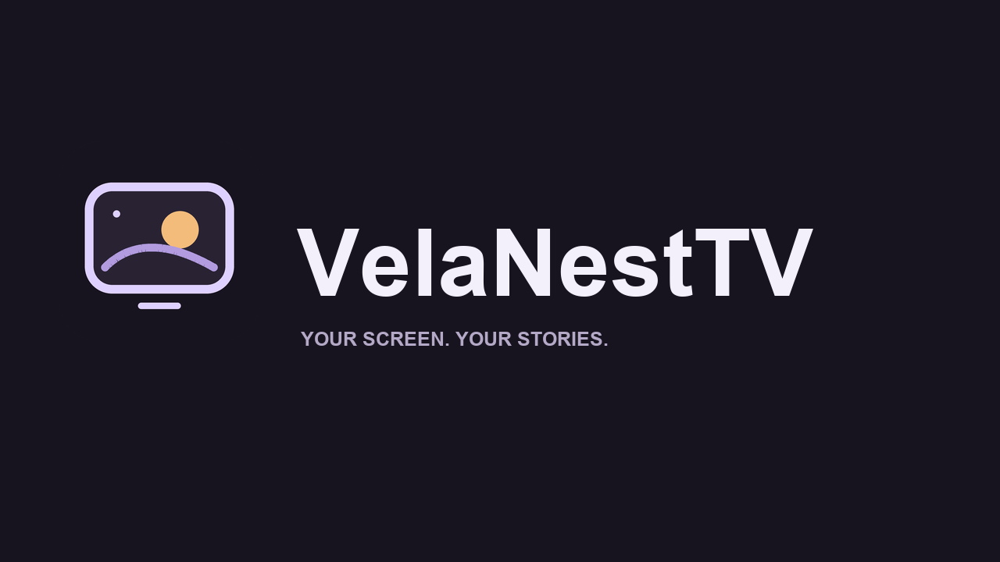

# VelaNestTV

**[中文安装、依赖环境与变量说明](docs/快速安装.md)**

A remote-friendly Android TV client with a self-hosted LibreTV backend and a lightweight companion service for search suggestions, recommendations, LAN discovery and a read-only local media library.

**Current version: 3.1.1. License: AGPL-3.0-or-later.** This repository contains the client, companion and backend source. It does not include passwords, signing keys, videos or a working third-party source list.

## Features

- TV sidebar navigation, poster wall and poster-backed featured section.
- Initial-letter/pinyin suggestions and full-title search.
- Episode/source selection, playback speed and manual intro/outro skipping for online content.
- User-configured M3U live subscriptions.
- Read-only NAS-style folder serving; independent local playback controls with available embedded audio/subtitle tracks.
- Saved connection/history and LAN rediscovery.

## Start here

1. Install Node.js 22.12+ LTS; install backend and companion dependencies with `npm ci`.
2. Copy backend/.env.example to backend/.env.local and companion/.env.example to companion/.env. Set matching passwords, your media folder and your own sources.
3. Build backend (`npm run build`), then run scripts/start.ps1.
4. Build the Android APK with JDK 8 and Android SDK 30/build-tools 30.0.3; install using USB or ADB.
5. On TV enter the PC LAN address and password.

**[Complete installation guide](docs/INSTALL.md)** · **[Variables and ports](docs/CONFIGURATION.md)** · [Third-party notices](THIRD_PARTY_NOTICES.md) · [Security](SECURITY.md) · [Contributing](CONTRIBUTING.md)

## Source layout

| Path | Purpose |
|---|---|
| android/app | Native Android Java source and UI resources |
| android/build.ps1 | APK compilation/signing script |
| backend | LibreTV backend source, original README/license and locked dependencies |
| companion | Node service, pinyin suggestions, catalog and signed local media delivery |
| branding | Project SVG/PNG brand assets |
| scripts | Windows start/stop scripts |
| docs | Installation and configuration |

## Compatibility and limits

Android 8.0 emulator and a Skyworth Android 8 TV have been used during development; the portable source packaging has not been tested on every device/OS. Native Android playback remains subject to hardware codecs and network/source quality. No external subtitles, NAS transcoder, internet-facing hardening or automatic source-health scheduler is included. Health is not a guarantee that every film/channel works.

Companion uses external recommendation/suggestion services; those may be unavailable or limited. TV app and companion currently expect port 8090 and discovery UDP 45831. Use a trusted LAN. See the installation guide for the exact build/upgrade signing requirements.

## License and credits

AGPL-3.0-or-later; see [LICENSE](LICENSE). Backend derives from [LibreSpark/LibreTV](https://github.com/LibreSpark/LibreTV), with original notices retained. See THIRD_PARTY_NOTICES.md for provenance and dependency scope. Preserve applicable license/source obligations when redistributing modified versions or operating modified network services.

The project is a software client/server tool. Provide your own authorized media sources. Remote posters/catalog data are not covered by ownership of this source repository.

## Maintenance

Version suggestions and support: [lcacvc@163.com](mailto:lcacvc@163.com). See the Chinese README for redacted screenshots and architecture.

