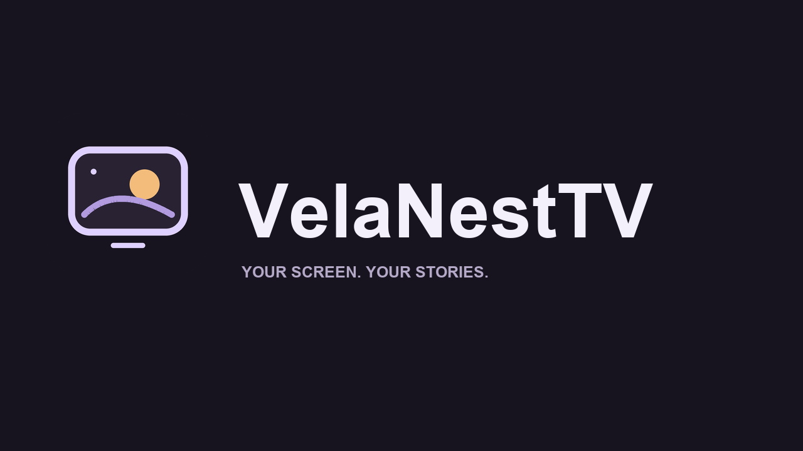
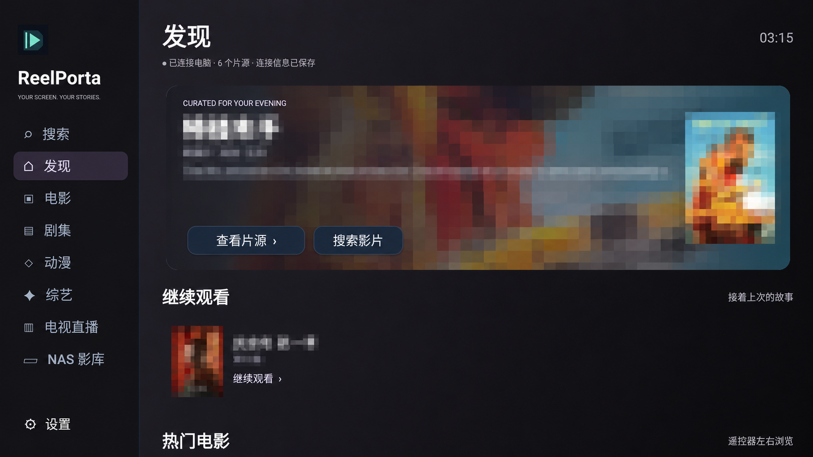
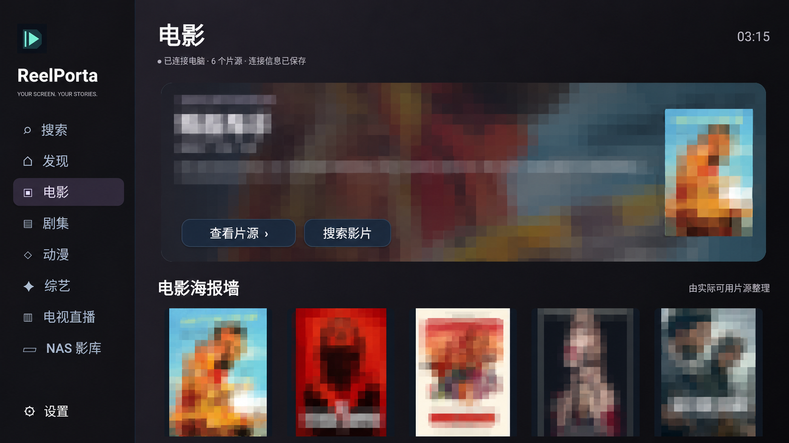
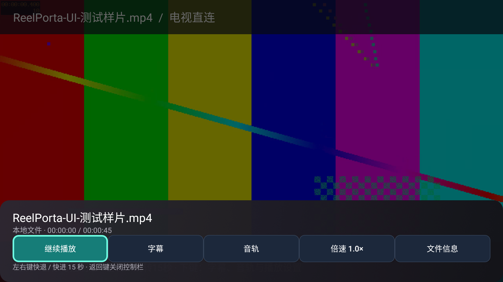

# VelaNestTV

一套面向家庭大屏的开源观影方案：电视负责浏览与播放，电脑负责搜索聚合、片单整理和本地文件服务。以遥控器为主要操作方式，支持在线点播、直播订阅和电脑本地影库。

**版本：3.1.1 · 许可证：AGPL-3.0-or-later · [English](README.en.md)**

## 功能

- **大屏界面**：侧栏分类、完整比例海报墙、海报背景推荐区及继续观看。
- **遥控器搜索**：首字母／拼音联想、关联片名和全名搜索，减少电视输入。
- **在线点播**：选集、切换片源、倍速、手动设定片头片尾跳过。
- **电视直播**：读取用户自行配置的 M3U 订阅。
- **本地影库**：只读访问电脑指定目录，提供独立播放控制栏、系统可识别的内嵌字幕与音轨选择。
- **连接记忆**：保存地址、密码和观看记录，支持局域网后台发现。

## 基本原理

项目由三个部分组成：

| 部分 | 职责 |
|---|---|
| Android TV 客户端 | 海报浏览、遥控器操作，使用 Android 原生播放组件播放视频 |
| LibreTV 后台 | 密码验证、用户配置片源的搜索与详情、直播与必要的播放代理 |
| Node.js 伴随服务 | 片单缓存、拼音／首字母索引、联想、局域网发现及只读 NAS 文件服务 |

电视通过局域网连接电脑。在线影片优先由电视直连播放地址，失败时尝试电脑代理；本地影片通过伴随服务生成限时签名 URL，支持 HTTP Range 请求以便拖动。片单和搜索结果依赖用户配置的来源及外部推荐／联想服务，不在项目中存储影视媒体。

电脑需要在观看时保持运行。局域网共享文件夹是轻量 NAS 式访问，不是完整 NAS 系统，也不提供转码。

## 界面截图

以下图片基于 **3.1 版本真实运行截图**，当时仍使用旧名称 ReelPorta；现版本已更名 VelaNestTV。首页及电影页的海报、剧情和影片名称经 AI 图像编辑进行模糊处理（局部文字边缘可能重绘），仅用于展示操作布局；模糊处理不表示获得影视素材授权。NAS 播放页展示自行生成的测试画面。

### 首页与继续观看

### 电影推荐与海报墙

### NAS 独立播放控制栏

## 安装步骤

**依赖**：Windows 10/11、Node.js 22.12+ LTS；构建 APK 另需 JDK 8、Android SDK platform 30 与 build-tools 30.0.3。电视最低 Android 5.0，开发验证主要使用 Android 8.0。其他电脑平台可以手动运行 Node 服务，尚未全面测试。

1. 获取源码，在 backend 和 companion 中分别执行 `npm ci`。
2. 将 backend/.env.example 复制为 backend/.env.local，将 companion/.env.example 复制为 companion/.env。设置相同的 PASSWORD，并配置自己的点播 API、直播订阅及 NAS_ROOT。
3. 在 backend 执行 `npm run build`，回到项目根目录运行 `powershell -ExecutionPolicy Bypass -File ./scripts/start.ps1`。
4. 设置 JAVA_HOME 和 ANDROID_SDK_ROOT，执行 `./android/build.ps1`，通过 U 盘或 ADB 安装输出的 APK。
5. 在电视输入 `http://电脑局域网IP:8080` 和 PASSWORD。电脑、电视需连接同一可信局域网。

**[完整中文安装步骤、变量及排障](docs/快速安装.md)** · [English installation](docs/INSTALL.md) · [Configuration](docs/CONFIGURATION.md)

**[如何自行搜索、验证和配置来源](docs/SOURCES.md)** · [部署测试与检查命令](docs/TESTING.md)。本仓库不提供具体点播源、直播订阅或播放链接，用户自行配置。

首次自编译会生成自己的签名密钥，无法默认覆盖维护者签名的安装包。同签名升级可直接覆盖安装，避免卸载造成配置和记录丢失。端口约定为后台 TCP 8080、伴随服务 TCP 8090、发现 UDP 45831；后两者在电视客户端固定；服务的端口覆盖仅用于隔离测试。

## 目录

| 路径 | 内容 |
|---|---|
| android/app | 原生客户端源码和界面资源 |
| android/build.ps1 | APK 编译与签名脚本 |
| backend | LibreTV 后台源码、上游说明与依赖锁文件 |
| companion | 伴随服务及本地文件服务 |
| branding | SVG／PNG 品牌源文件 |
| scripts | Windows 启动／停止脚本 |
| docs | 安装、配置及验证记录 |

## 维护与版本建议

维护邮箱：**[lcacvc@163.com](mailto:lcacvc@163.com)**

欢迎通过 GitHub Issues 或邮件反馈问题、版本建议与兼容性情况。请提供应用版本、电视型号、Android 版本、操作步骤及已脱敏日志。不要发送密码、Cookie、签名链接、密钥或私人媒体文件。安全问题请优先私下联系维护邮箱。

[贡献说明](CONTRIBUTING.md) · [安全说明](SECURITY.md) · [验证范围](docs/VALIDATION.md)

## 开源范围、限制与署名

采用 **AGPL-3.0-or-later**，详见 [LICENSE](LICENSE)。提供客户端、伴随服务、后台和品牌图标源码；后台基于 [LibreSpark/LibreTV](https://github.com/LibreSpark/LibreTV)，保留原始署名与许可，详见 [THIRD_PARTY_NOTICES.md](THIRD_PARTY_NOTICES.md)。第三方依赖适用各自许可证。

不分发个人密码、签名密钥、媒体文件、缓存或第三方片源列表。请自行配置有权访问的内容。远程海报、影片和第三方数据不属于本项目的原创资源。

项目面向可信家庭局域网，勿直接映射到公网。网络、片源和电视解码能力影响流畅度，不保证所有 4K 内容或所有频道可用。外挂字幕、转码、自动片源巡检尚未实现；外部推荐与联想服务可能限流。公开版已通过的检查及尚未验证的范围见验证记录。

